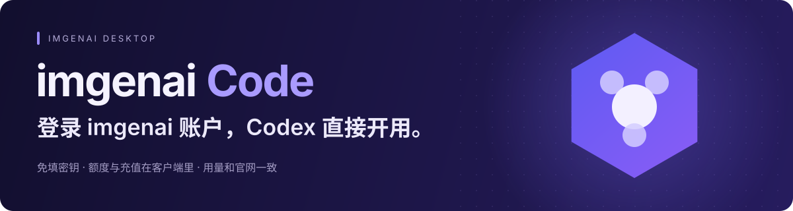

<!-- 仓库首页。GitHub 优先显示 .github/README.md，根目录的 README.md 保持上游原样，合并上游更新时不冲突。 -->

  

  <strong>imgenai 的桌面客户端。</strong> 
  不用复制密钥、不用改配置文件，订阅额度、充值和用量都在客户端里。

  
  
  

  <a href="https://github.com/gaoennan/imgenai-code/releases"><strong>下载最新版 ↗</strong></a> &nbsp; · &nbsp;
  <a href="https://imgenai.net">imgenai 官网</a> &nbsp; · &nbsp;
  <a href="#快速上手">快速上手</a> &nbsp; · &nbsp;
  <a href="#常见问题">常见问题</a> &nbsp; · &nbsp;
  <a href="README_EN.md">English</a>

imgenai Code 是 [imgenai](https://imgenai.net) 的桌面客户端，在开源项目 [Codex++](https://github.com/BigPizzaV3/CodexPlusPlus) 的基础上修改而来。登录 imgenai 账户后，客户端自动取得专用密钥并把 imgenai 加进供应商池，Codex 里选 imgenai 的模型就能直接用。Codex++ 原有的本地网关、会话管理、Codex 界面增强等功能全部保留。

## 多了什么

| 功能 | 说明 |
| --- | --- |
| **登录即用** | 用 imgenai.net 的手机号登录，客户端自动创建「桌面客户端」专用密钥并写进供应商池，不用手抄密钥；也可以在客户端里新建、删除密钥，或改用网站上建好的任意一把 |
| **多账号** | 可以同时登录多个 imgenai 账号，在账户页一键切换，不用重新输密码 |
| **上手指引** | 打开客户端时弹出，一步步带着登录、开通、接入 Codex，要点的按钮直接圈出来，做完一步自动打勾，做完的步骤也能点开回看；不想每次看到就在欢迎卡上勾「以后不再弹出」，侧栏「上手指引」随时重新打开 |
| **额度与充值** | 查看订阅档位、今日已用和剩余额度；订阅、加油包扫码支付；使用重置卡、开通免费试用 |
| **用量对得上** | 客户端「用量」页按 imgenai 的价格计费，和官网扣费一致 |
| **Max 与 Ultra 档位** | Codex 的推理强度里补上 Max 和 Ultra |
| **旧对话照常打开** | 接入后，以前用其他供应商建的对话不会报「提供商已移除配置」 |
| **首轮不卡顿** | 上游不支持 WebSocket 时自动改走 HTTP，Codex 不再等十几秒才出字 |
| **微信连接** | 扫码把微信接到本机 Codex |

继承自 Codex++ 的部分：50 多个 Agent 共用一份供应商池的本地网关、Codex 与 Claude Code 的会话管理、Codex 界面增强与多开、拓展、Computer Use 共享等，介绍见 [Codex++ 项目主页](https://github.com/BigPizzaV3/CodexPlusPlus)。

## 快速上手

打开客户端会弹出「上手指引」，跟着点就行。下面是同样的几步。

**1. 下载安装包**：国内直连下载最新版 [macOS](https://api.imgenai.net/download/mac) · [Windows](https://api.imgenai.net/download/win) · [Windows 免安装版](https://api.imgenai.net/download/win-zip)，也可以前往 [Releases](https://github.com/gaoennan/imgenai-code/releases)。

| 你的设备 | 安装包 |
| --- | --- |
| macOS · Apple 芯片 / Intel | `imgenaiCode-版本号-macos-universal.dmg` |
| Windows · x64 | `imgenaiCode-版本号-windows-x64-setup.exe`，免安装版为 `-windows-x64.zip` |

**2. 登录账户**：打开 imgenai Code，进入侧栏「聚合网关 → imgenai 账户」，用 imgenai.net 的手机号和密码登录。还没有账号的话先到 [官网](https://imgenai.net) 注册。

**3. 开通订阅**：账户页里选档位扫码支付，或先开通免费试用。开通后 imgenai 会自动出现在「供应商池」里。

**4. 接入 Codex**：在上手指引里点「一键接入」；也可以到侧栏「Codex 接入」，点 Codex 那一行的「默认模型」，选 imgenai 下的任意模型。最后点「启动 Codex」。

## 常见问题

  
<strong>安装后打不开，提示「Windows 已保护你的电脑」或「无法验证」怎么办？</strong>

Windows 安装包暂未做代码签名，点「更多信息」，再点「仍要运行」即可。

macOS 安装包已用 Apple 开发者证书签名，但 Apple 公证还在排队。从网页下载后第一次打开会提示 Apple 无法验证它是否包含恶意软件，先点「完成」，再到「系统设置 → 隐私与安全性」底部点「仍要打开」并输入开机密码，之后就能正常打开。macOS 14 及更早的系统也可以在「应用程序」里按住 Control 点 imgenai Code，选「打开」。在客户端里点「安装」更新不会出现这个提示。

  
<strong>想换回官方 ChatGPT 订阅怎么办？</strong>

在「Codex → 连接与供应商」顶部把「连接方式」切到「直连」，选官方登录后从客户端重启 Codex。之后想再用 imgenai，切回「经网关」即可。

  
<strong>不开 imgenai Code，Codex 还能用吗？</strong>

能。客户端默认开机启动并常驻托盘，关掉窗口也在后台运行。完全退出客户端时，Codex 会自动改为直连 imgenai，下次打开客户端再切回网关；客户端关着的这段时间只能用 imgenai 的模型，用量页等网关功能要等客户端打开后才有。1.0.2 及更早的版本没有这项处理，退出客户端后 Codex 会一直重连，请升级。

  
<strong>开着代理软件时，Codex 报「502 Bad Gateway: Unknown error」怎么办？</strong>

这是 Codex 把发往本机网关（127.0.0.1）的请求也交给了代理软件，对话里图片一多、请求变大后在代理那里失败。1.0.4 起，Windows 版客户端启动时会自动把 `localhost,127.0.0.1,::1` 加进当前用户的环境变量 `NO_PROXY`，更新后完全退出并重新打开一次 Codex 即可，代理照常开着。旧版本可以手动添加这个环境变量，或者临时关掉代理。

  
<strong>账号和密钥存在哪里？</strong>

客户端只保存网站返回的登录令牌，不保存密码；令牌和中转密钥都只存在本机，界面里只显示打码后的样子。登录了多个账号时，供应商池里的 imgenai 用的是当前账号的密钥，切换账号会跟着换。退出最后一个账号后，imgenai 会从供应商池移除。

  
<strong>怎么更新？</strong>

客户端会检查新版本并在侧栏提示，点「安装」即可。检查和下载先走国内下载站 api.imgenai.net，连不上时改走本仓库 Releases。也可以随时到 [Releases](https://github.com/gaoennan/imgenai-code/releases) 下载新版覆盖安装，配置与会话会保留。

## 反馈

订阅、扣费、账户相关的问题请到 [imgenai 官网](https://imgenai.net) 联系客服。客户端的问题可以在本仓库提 [Issue](https://github.com/gaoennan/imgenai-code/issues)，附上系统、imgenai Code 版本和复现步骤，贴日志前请隐去密钥、令牌和手机号。

## 开源与许可

imgenai Code 基于 [Codex++](https://github.com/BigPizzaV3/CodexPlusPlus) 修改，按 [GNU AGPL v3.0](https://github.com/gaoennan/imgenai-code/blob/main/LICENSE) 公开全部源码，第三方组件的许可见 [THIRD_PARTY_NOTICES.md](https://github.com/gaoennan/imgenai-code/blob/main/THIRD_PARTY_NOTICES.md)。和上游的差别集中在 [scripts/imgenai](https://github.com/gaoennan/imgenai-code/tree/main/scripts/imgenai) 与 `assets/extensions/imgenai-account`。感谢 Codex++ 的作者与贡献者。

本项目与 OpenAI 无关，不授予 OpenAI、ChatGPT、Codex 等商标的任何权利。
