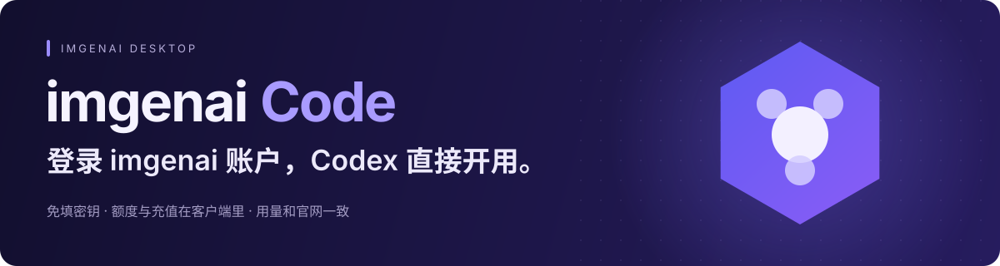

  

  <strong>The desktop client for imgenai.</strong> 
  No keys to copy, no config files to edit. Quota, top-ups and usage all live in the app.

  <a href="https://github.com/gaoennan/imgenai-code/releases"><strong>Download ↗</strong></a> &nbsp; · &nbsp;
  <a href="https://imgenai.net">imgenai.net</a> &nbsp; · &nbsp;
  <a href="README.md">中文</a>

imgenai Code is the desktop client for [imgenai](https://imgenai.net), built on the open-source project [Codex++](https://github.com/BigPizzaV3/CodexPlusPlus). After you sign in, the app creates a dedicated key and adds imgenai to the provider pool, so Codex can use imgenai models right away. Everything Codex++ offers (the local gateway, session management, Codex UI enhancements) is still there.

## What it adds

| Feature | Details |
| --- | --- |
| **Sign in and go** | Sign in with your imgenai.net phone number; a dedicated "desktop client" key is created and written into the provider pool, or create, delete and switch between your keys right in the app |
| **Multiple accounts** | Stay signed in to several imgenai accounts and switch between them in one click, without typing the password again |
| **Getting started guide** | Opens when the app starts and walks you through signing in, subscribing and connecting Codex, highlights what to click, and checks off each step as it's done (finished steps can be reopened); tick "Don't show on startup" to stop it popping up, and reopen it any time from "上手指引" (Getting started) in the sidebar |
| **Quota and top-ups** | See your plan, today's usage and remaining quota; pay for plans and boost packs by QR code; use reset cards or start a free trial |
| **Matching usage** | The Usage page prices requests with imgenai's rates, so it matches what the website charges |
| **Max and Ultra** | Adds Max and Ultra to Codex's reasoning effort menu |
| **Old chats keep working** | Chats created with other providers no longer report "provider configuration removed" |
| **No first-turn stall** | Falls back to HTTP when the upstream rejects WebSocket, instead of waiting a dozen seconds |
| **WeChat** | Scan a QR code to connect WeChat to Codex on this computer |

## Getting started

When you open the app, a getting-started guide walks you through these steps.

1. Download the latest build from the mainland China mirror ([macOS](https://api.imgenai.net/download/mac) · [Windows](https://api.imgenai.net/download/win)) or from [Releases](https://github.com/gaoennan/imgenai-code/releases): `imgenaiCode-<version>-macos-universal.dmg` for macOS (Apple silicon and Intel) or `imgenaiCode-<version>-windows-x64-setup.exe` for Windows.
2. Open imgenai Code, go to "imgenai 账户" (imgenai account) under the gateway section, and sign in with your imgenai.net account.
3. Subscribe by QR code or start a free trial. imgenai then appears in the provider pool.
4. Click "Connect for me" in the guide, or open "Codex 接入" (Codex setup) in the sidebar, click the default model on the Codex row and pick any model under imgenai. Then launch Codex.

The Windows installer is not code-signed yet. If SmartScreen appears, click "More info" and then "Run anyway". The macOS build is signed with an Apple Developer ID, but Apple notarization is still pending. The first time you open a copy downloaded from the web, macOS says it cannot verify the app is free of malware. Click "Done", go to System Settings → Privacy & Security, click "Open Anyway" near the bottom and enter your password. On macOS 14 and earlier you can also Control-click imgenai Code in Applications and choose "Open". Updating from inside the app does not show this prompt.

## License

imgenai Code is a modified version of [Codex++](https://github.com/BigPizzaV3/CodexPlusPlus). The complete source code is published under the [GNU AGPL v3.0](https://github.com/gaoennan/imgenai-code/blob/main/LICENSE); third-party notices are in [THIRD_PARTY_NOTICES.md](https://github.com/gaoennan/imgenai-code/blob/main/THIRD_PARTY_NOTICES.md). Thanks to the Codex++ authors and contributors.

This project is not affiliated with OpenAI and grants no rights to OpenAI, ChatGPT, Codex or other trademarks.
